# Отчёт по лабораторной работе №2 (Node-RED)

**Студент:** Помас Илья  
**Группа:** УИР-241
**Дата:** 24.10.2026

## Краткое описание выполненного
В ходе лабораторной работы я освоил Node-RED как low-code инструмент для визуального программирования. Я собрал 12 потоков, охватывающих базовые и продвинутые ноды, научился работать с API, MQTT, Telegram-ботами и контекстом. 
Дополнительно выполнил **ачивку №9 — API key + rate limit** (защита REST API с помощью ключа и ограничение частоты запросов).

## Способ установки и версии
*   **Способ установки:** Docker (образ `nodered/node-red`).
*   **Node.js version:** v20.x.x (указать вашу версию, которую вы видели в About).
*   **Node-RED version:** v4.x.x (указать вашу версию из About).

## Освоенные ноды
*   **Базовые:** `inject`, `debug`, `function`, `switch`, `change`, `template`.
*   **Сетевые:** `http request`, `http in`, `http response`, `mqtt in`, `mqtt out`.
*   **Dashboard:** `ui_gauge`, `ui_chart`.
*   **Telegram:** `telegram receiver`, `telegram sender`.
*   **Файлы:** `file in` (read file), `file out` (write file).
*   **Контекст:** работа через `flow.get/set`, `global.get/set`.
*   **Безопасность (Ачивка 9):** проверка заголовков (`msg.req.headers`), `global context` для хранения счетчика запросов.

## Использованные AI-промпты (примеры)
1. *"Напиши Function-ноду с базовыми элементами JavaScript: let/const, if/else, цикл for, массив, объект. Функция должна возвращать объект с полем payload."* (для пункта 2.2).
2. *"Помоги составить Mustache-шаблон, который формирует JSON из входящего объекта с полями name, group, lab."* (для пункта 2.5).
3. *"Как в Node-RED реализовать проверку API-ключа в заголовке X-API-Key и ограничение частоты запросов (rate limit) с возвратом ошибки 429?"* (для ачивки 9).

---

## Скриншоты

### Часть 1. Версия Node-RED и Node.js
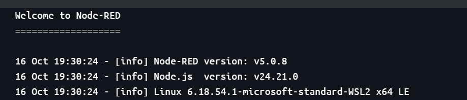

### Часть 2.1 — Inject → Debug
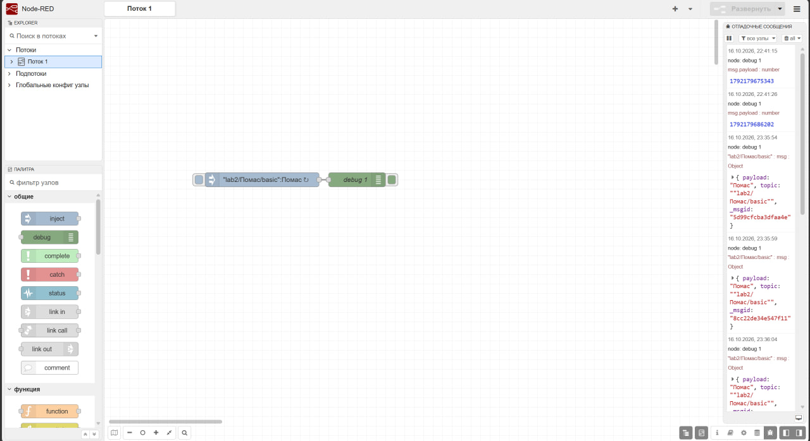

### Часть 2.2 — Function node
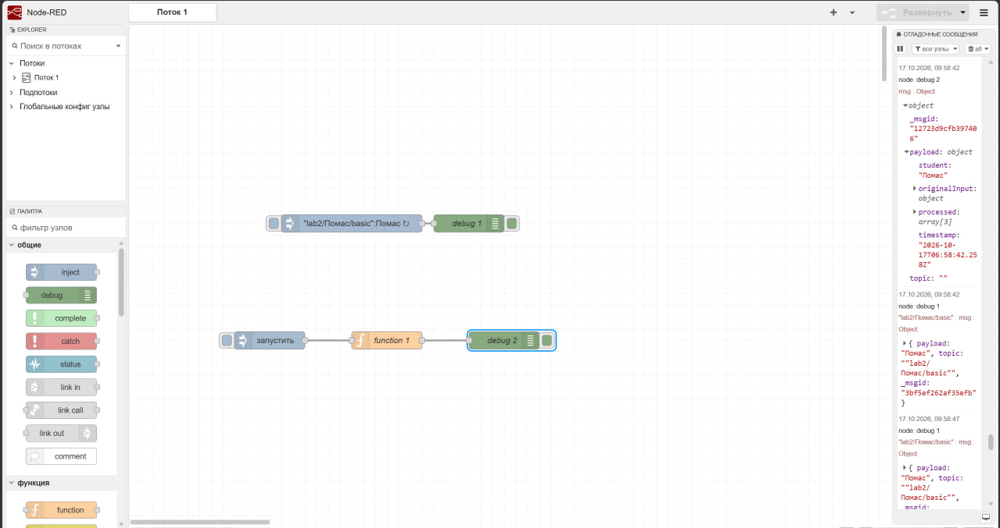

### Часть 2.3 — Switch node
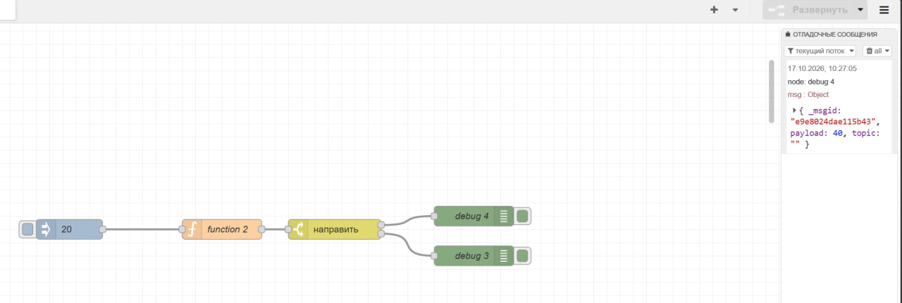

### Часть 2.4 — Change node
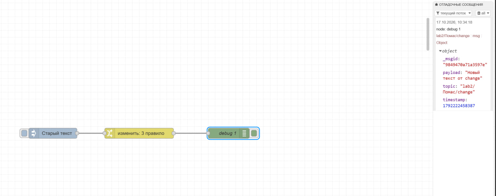

### Часть 2.5 — Template node
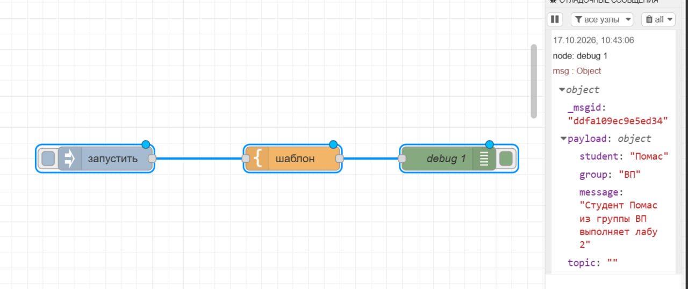

### Часть 2.6 — HTTP Request
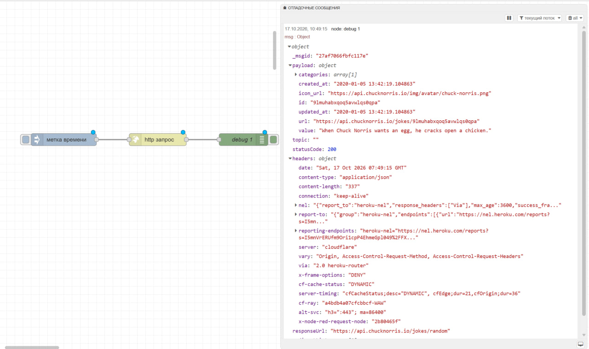

### Часть 2.7 — MQTT
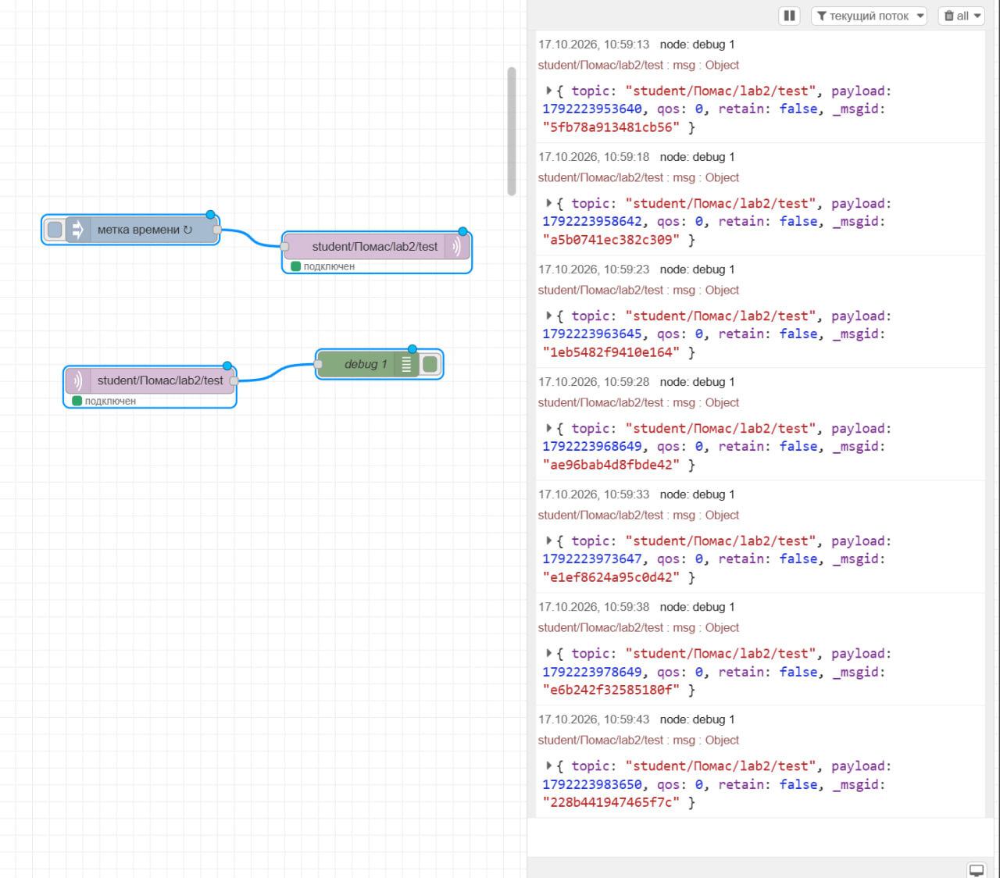

### Часть 2.8 — GET-эндпоинты
*(Примечание: если у вас сохранено несколько скриншотов для 2.8, замените имена файлов ниже на ваши)*

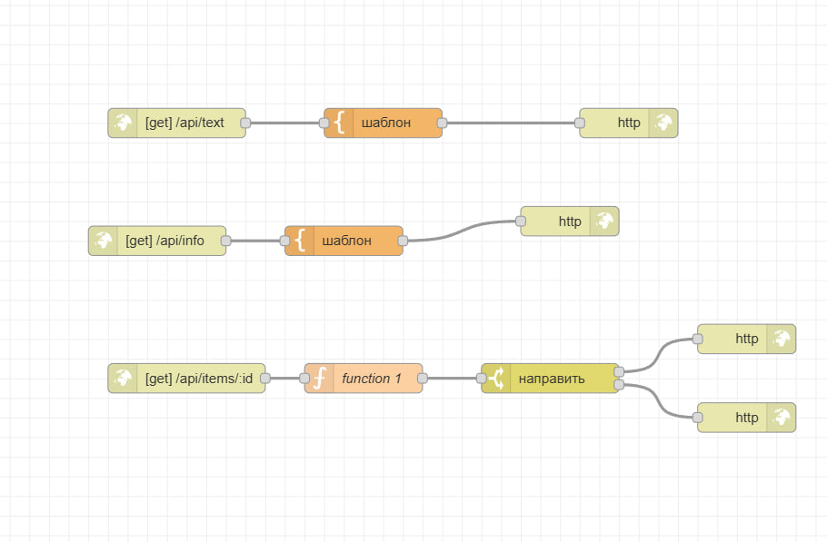
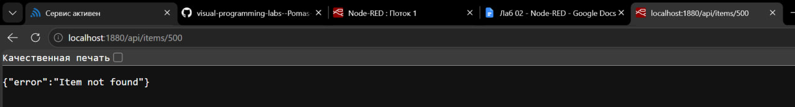
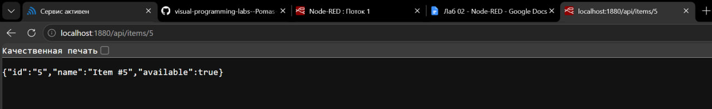
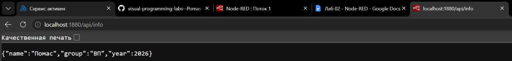
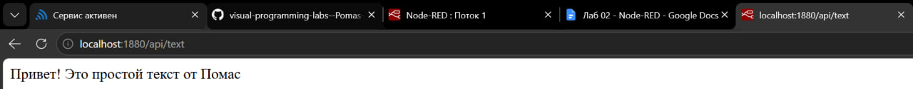

### Часть 2.9 — Dashboard
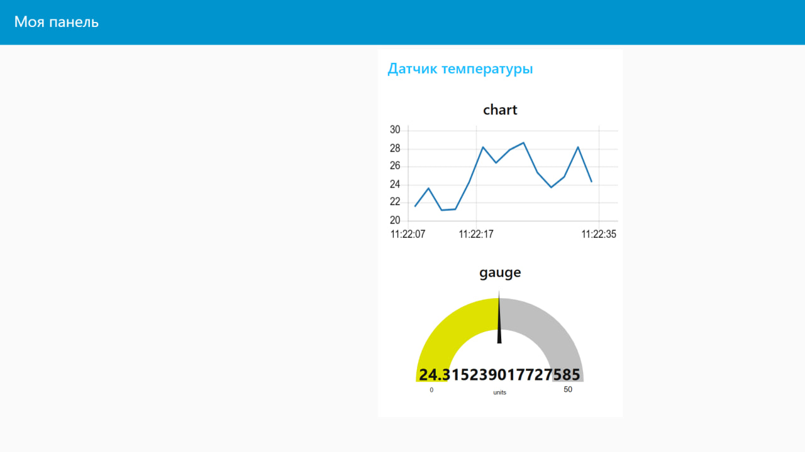
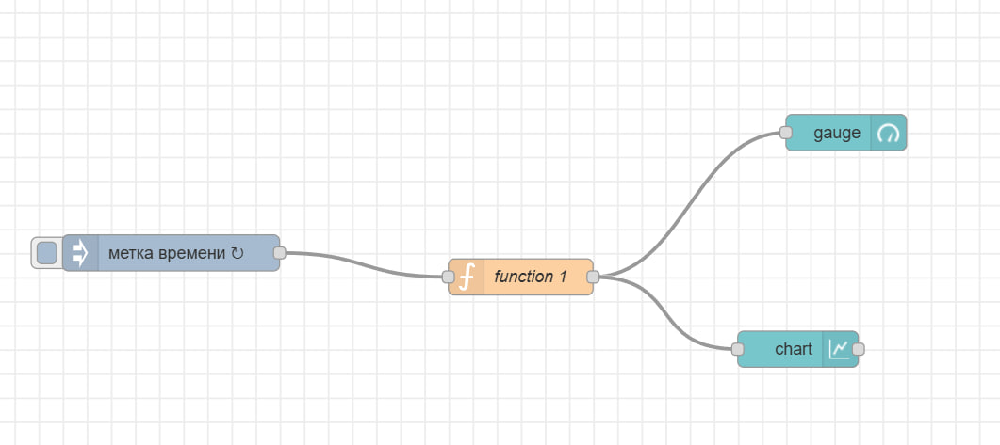

### Часть 2.10 — Telegram-бот
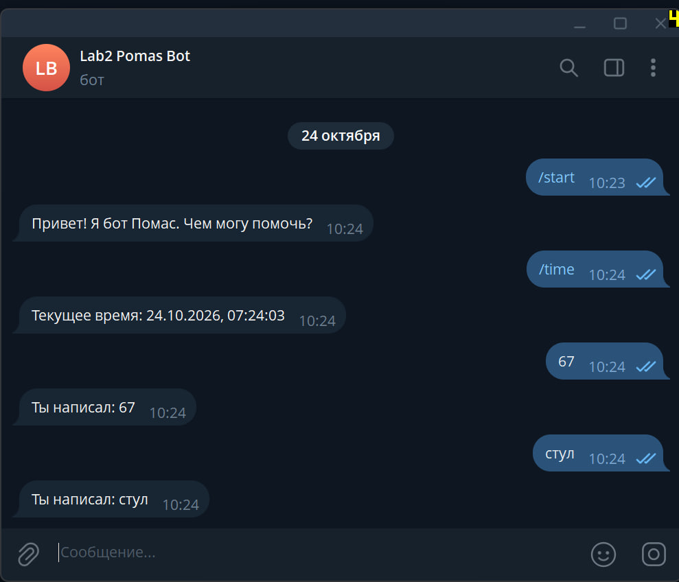

### Часть 2.11 — Файлы
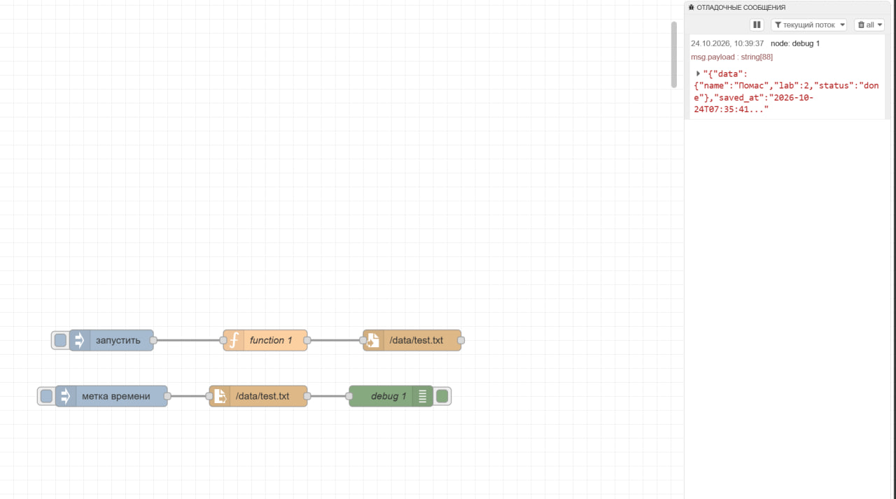

### Часть 2.12 — Контекст
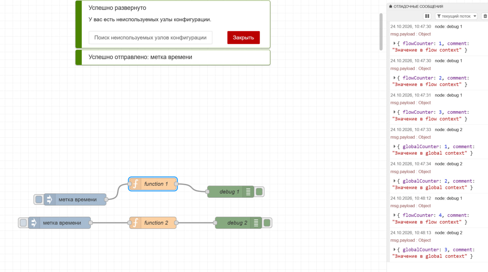

### Ачивка 9 — API key + rate limit
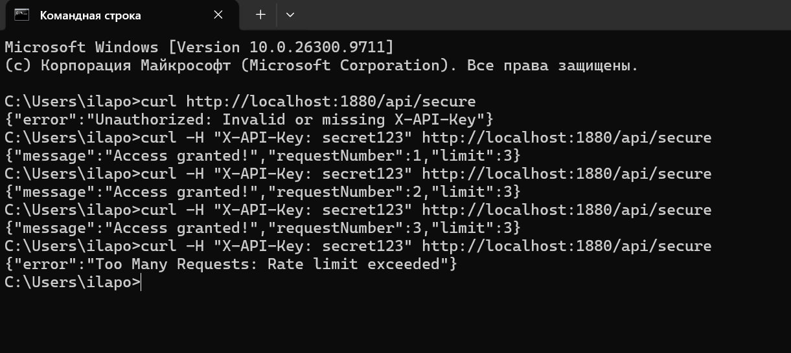

---

## Вывод
Во время выполнения работы я освоил основные ноды в Node-RED, их связь и понял, в каких сферах это применимо. Node-RED действительно способен облегчить жизнь тем, кто не хочет разбираться в синтаксисе JS, но при этом хочет, например, создать Telegram-бота или быстро поднять REST API. 

Также я познакомился с механизмом контекста (`flow` и `global`), который позволяет сохранять состояние между сообщениями, и с работой с файлами. Выполнение ачивки по защите API показало, как можно реализовывать базовую безопасность (ключи и лимиты) исключительно силами Node-RED, без написания отдельного сервера.