# Отчёт по лабораторной работе №3 (Bubble)

**Студент:** Помас Илья\
**Группа:** УИР-241\
**Дата:** 30.10.2026

**Тема:** Список фильмов\
**Ачивка:** 1 (API Connector) *(или 2, если выберете плагины)*

------------------------------------------------------------------------

## Часть 1. Промпт и генерация каркаса

### Промпт (дословно)

    Создай приложение на тему «Дневник питания»
    Создай приложение на тему «Список фильмов»
    Пусть этот сайт будет требующий регистрацию
    Страницу обязательно создай по структуре header + body + footer
    Обязательно укажи в заготовке следующую строку: «ТВП: Помас»
    Добавь несколько интерактивных элементов (реализующих CRUD)

### Результат генерации

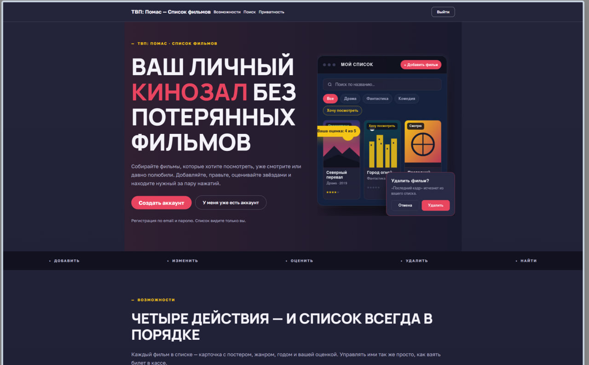
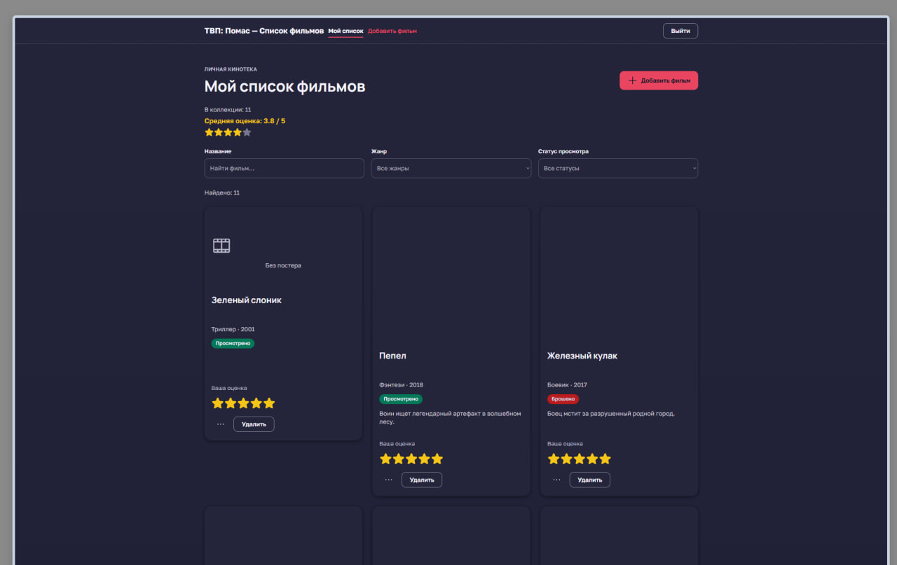

## Часть 2. Исследование идеи

### Изученные источники

**Источник:** Официальные Build Guides платформы Bubble
**Что посмотрел:** пошаговые руководства по настройке регистрации/авторизации (User registration and login), отображению списка данных (Movie list display) и базовой структуре страницы (Header, body, and footer structure).
**Что показалось полезным:** 
  1. Гайд по регистрации объяснил, как связать форму на сайте с базой данных пользователей (User), чтобы создавать учетные записи и выполнять вход. 
  2. Гайд по структуре помог понять, как правильно организовать элементы на странице (шапка, тело, подвал), чтобы интерфейс выглядел аккуратно.
**Что взял в приложение:** Реализовал полноценную регистрацию и авторизацию через Workflows (Sign the user up / Log the user in). Также настроил ограничение поиска данных (Created by = Current User), чтобы каждый пользователь видел только свои записи после входа.

### Скриншоты

**Идея (из гайда):**

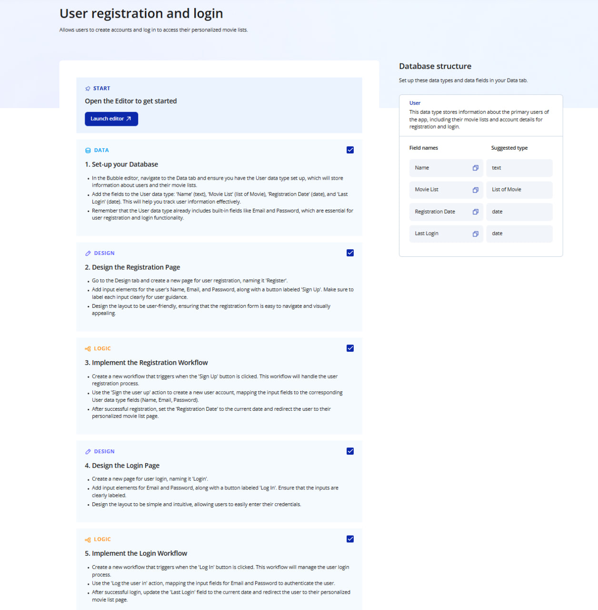

**Реализация в моём приложении:**

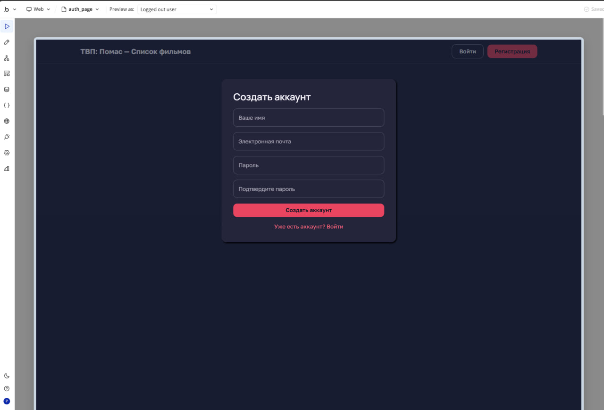
## Часть 3. Ручная доработка UI

### 3.1. Изменение текста заголовка

Заголовок страницы изменён вручную. Текст «Список фильмов» дополнен именем студента (Илья). Строка «ТВП: Помас» сохранена.

### 3.2. Global variable для цвета

Создал глобальную переменную `primary-color` типа Color (зелёный цвет). Применил её к фону кнопок на странице.

### 3.3. Новый стиль

Создал новый стиль для кнопки, использующий переменную `primary-color`. Применил стиль к кнопкам на странице.

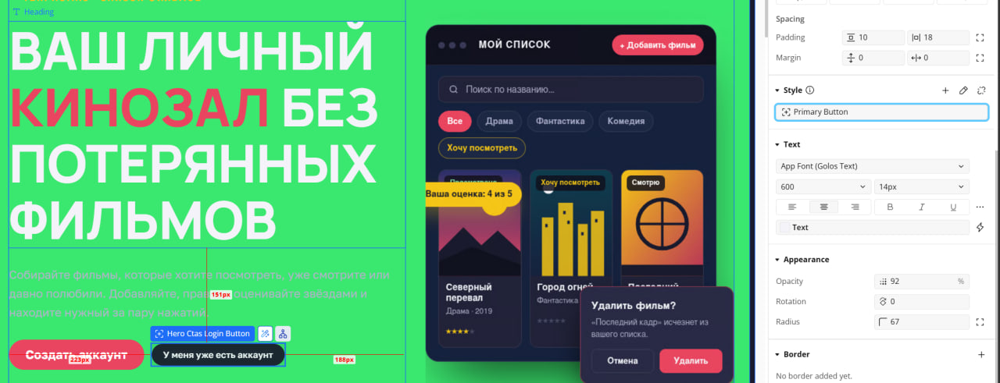

### 3.4. Готовый компонент

Добавил готовый компонент из UI Components — блок навигации/футер. Настроил его под свою тему (цвет, шрифт).

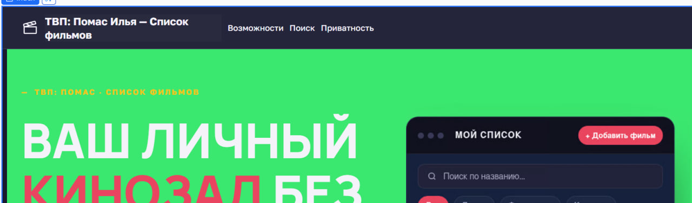

## Часть 4. Data и Workflows

### 4.1. Data: новая сущность

**AI-промпт:**
Я делаю приложение «Список фильмов» на Bubble (no-code).
Предложи новую сущность (Data Type) для отзывов к фильмам.
Нужно минимум 3 поля разных типов (text, number, date, yes/no).
Дай название сущности, список полей с типами и кратким описанием.

text

**Ответ AI:**

Предлагаю сущность **`Review`** (Отзыв).

| Поле | Тип | Описание |
|---|---|---|
| `Text` | text | Текст отзыва |
| `Rating` | number | Оценка фильма (от 1 до 10) |
| `Date` | date | Дата написания отзыва |
| `IsSpoiler` | yes/no | Содержит ли отзыв спойлеры |

Всего 4 поля разных типов (text, number, date, yes/no) — соответствует требованию «минимум 3 поля разных типов».

**Созданная сущность в Bubble:**

Тип данных `Review` с полями разных типов.

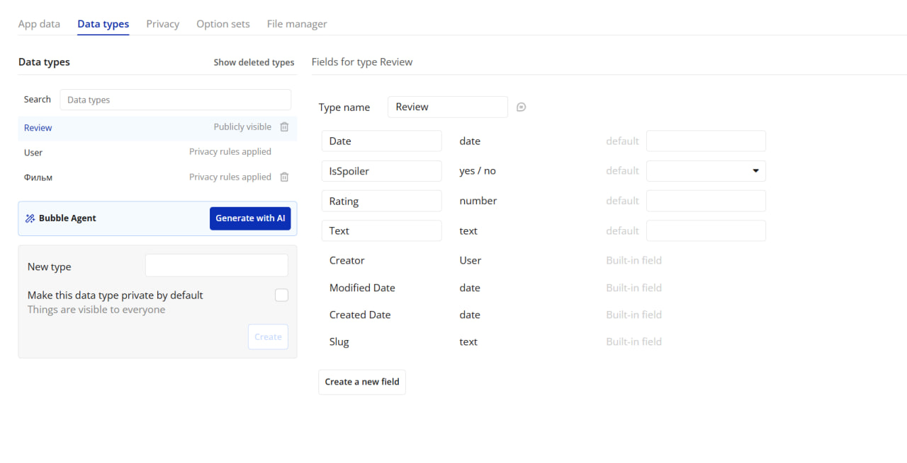

**Записи в App Data:**

Добавил 3 записи вручную.

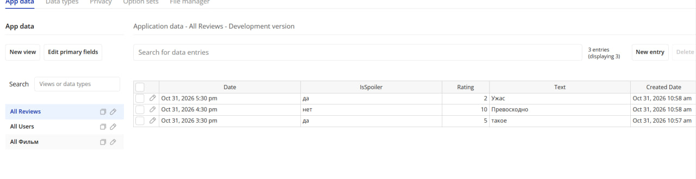

### 4.2. Workflows: CRUD

**AI-промпт для генерации UI:**
Создай на новой странице «reviews» интерфейс для CRUD-операций
с сущностью «Review» (Отзыв). Поля: Text (text),
Rating (number), Date (date), IsSpoiler (yes/no).

Нужно:

Кнопка «Добавить отзыв» — открывает Popup с формой.

Repeating Group со списком всех отзывов — в каждой ячейке
текст, рейтинг, дата, статус спойлера, кнопки «Редактировать» и «Удалить».

Кнопка «Редактировать» открывает тот же Popup с заполненными полями.

Кнопка «Удалить» удаляет запись.

text

**Реализованные workflows:**

- **Create**: форма с полями -> кнопка «Сохранить» -> Create a new thing (Review) + Reset inputs.
- **Read**: Repeating Group с `Search for Reviews`.
- **Update**: кнопка «Редактировать» -> Make changes to a thing (Current cell's Review).
- **Delete**: кнопка «Удалить» -> Delete a thing (Current cell's Review).

**Скриншоты:**

**Create (создание записи):**
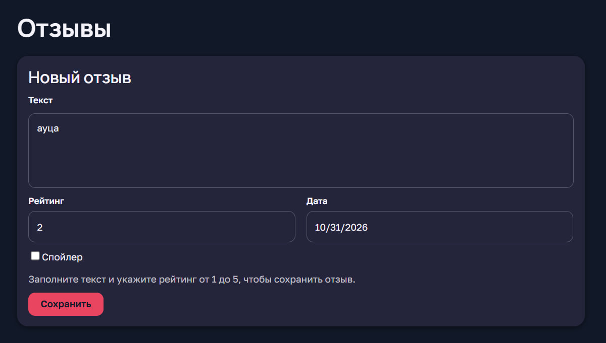

**Update (редактирование записи):**
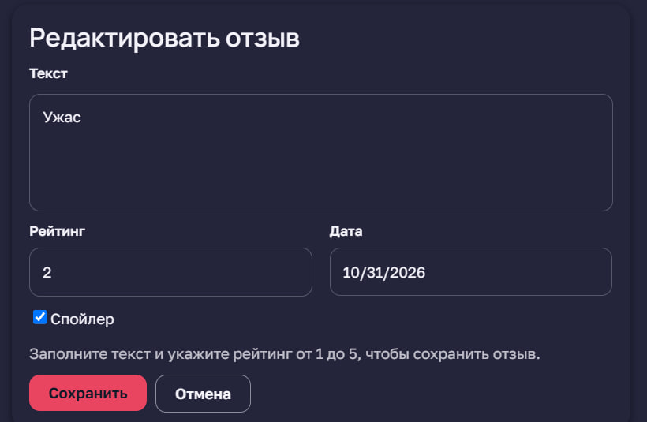

**Delete (удаление записи):**
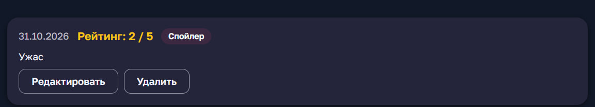
