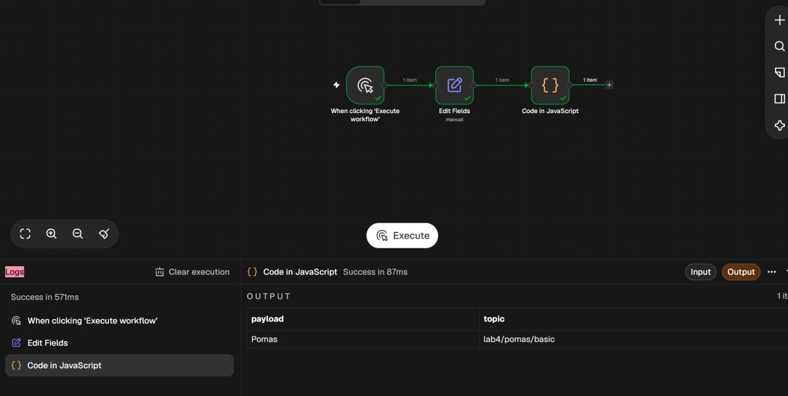
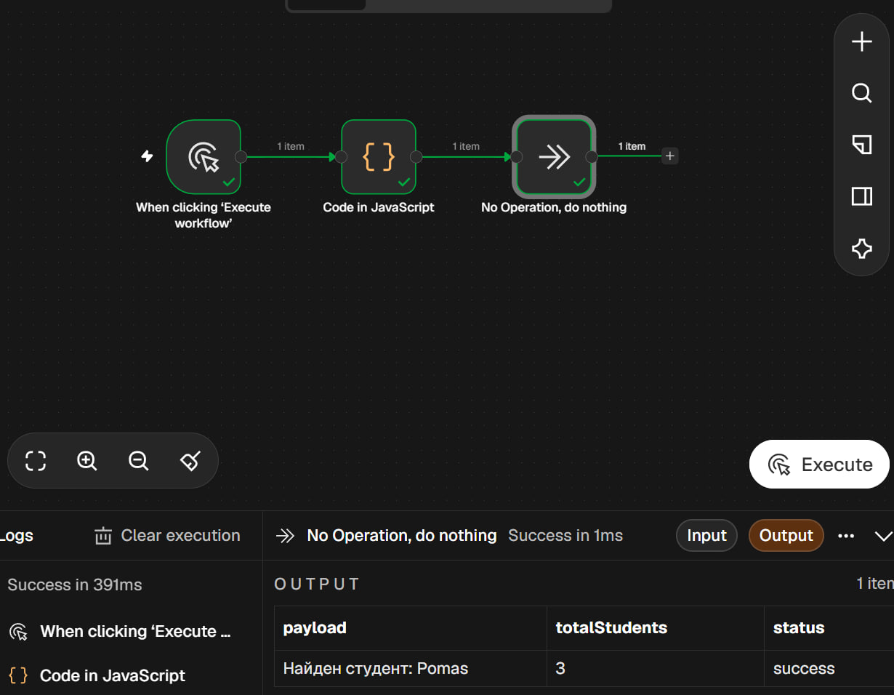
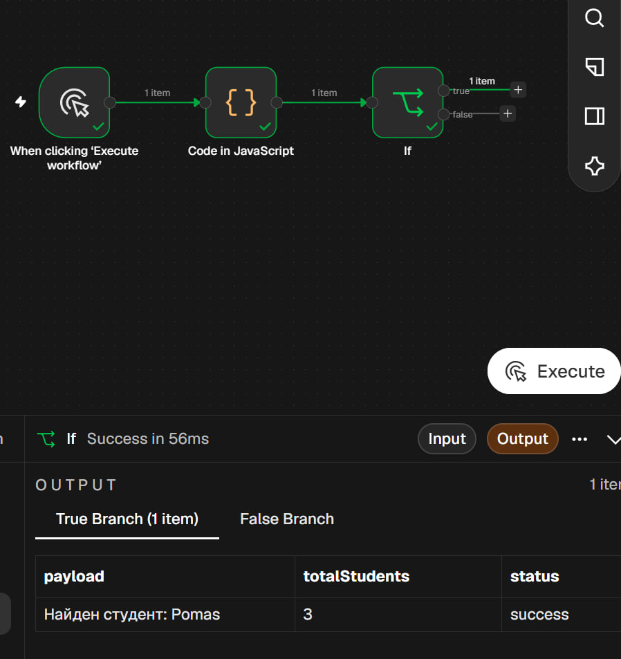
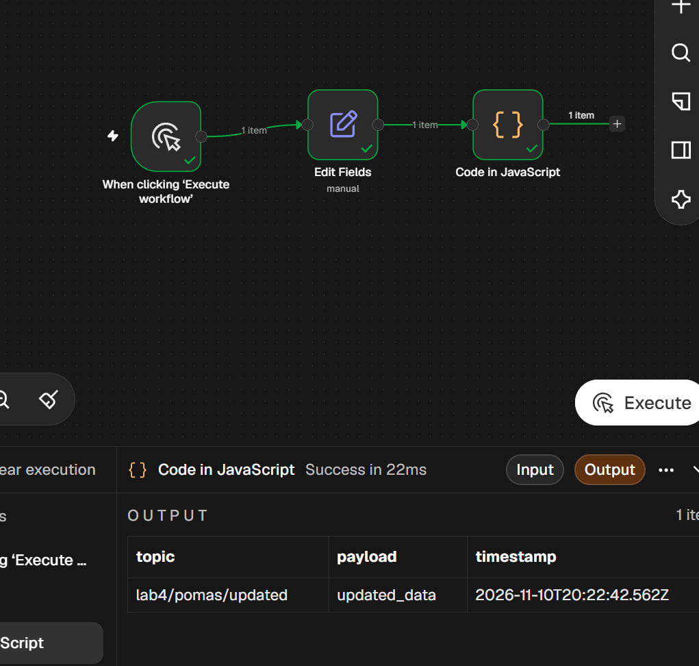
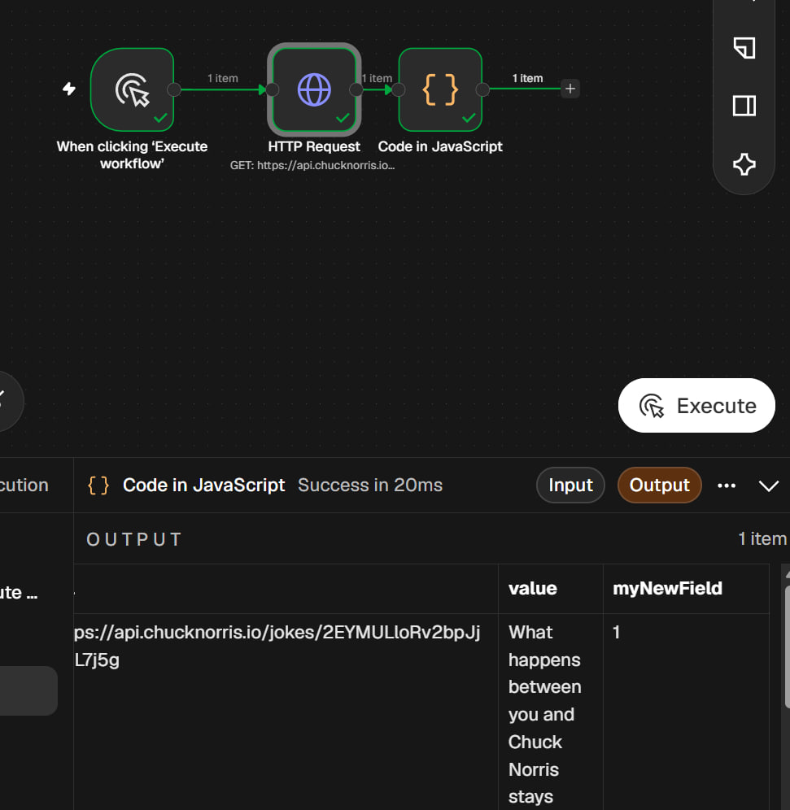
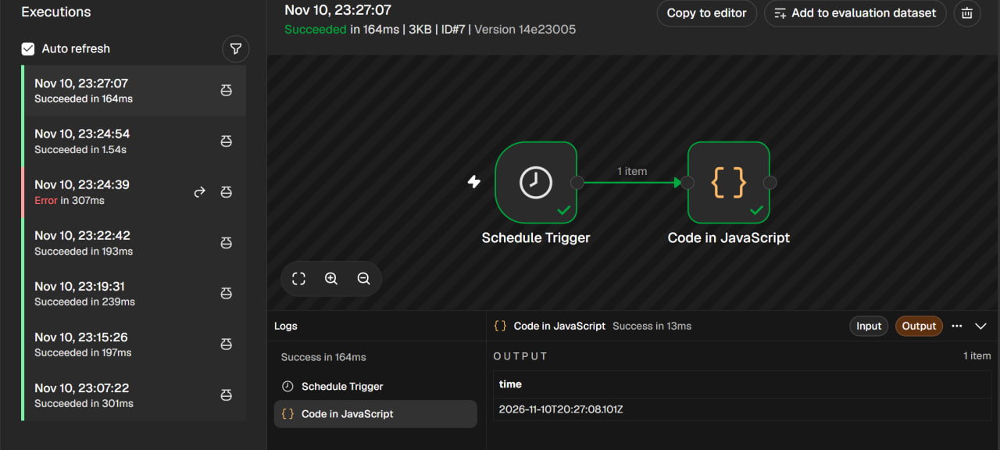
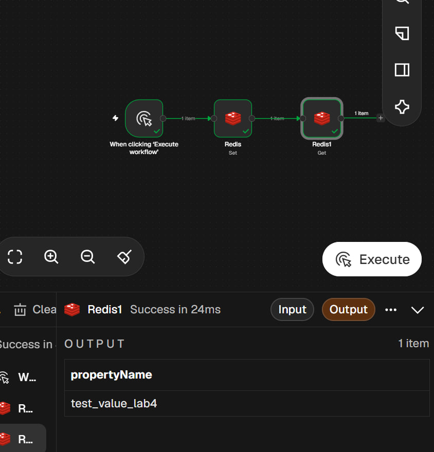
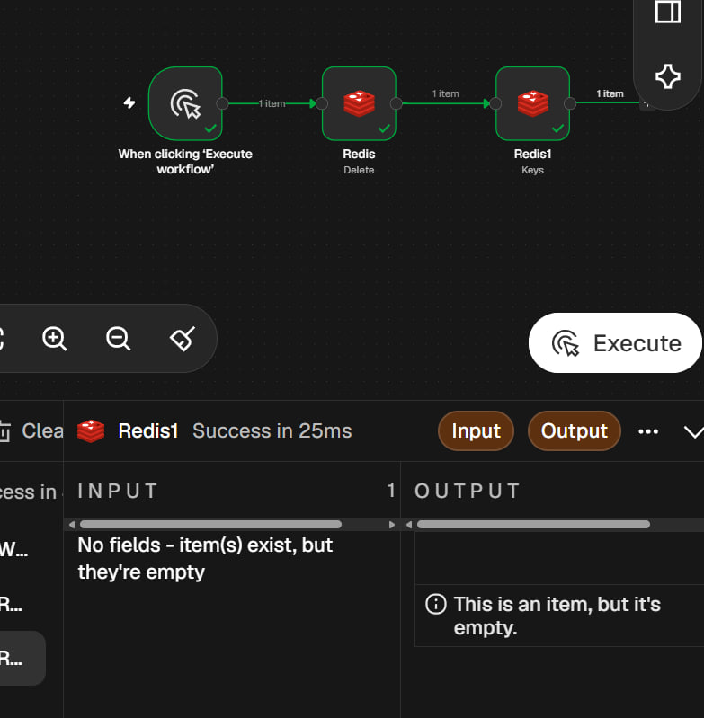
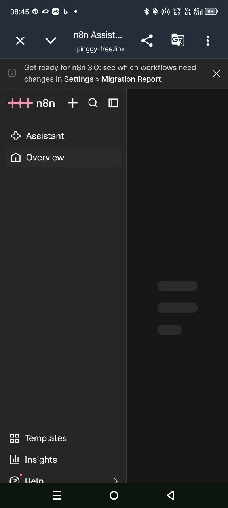

# Отчёт по лабораторной работе №4 (n8n)

**Студент:** Помас Илья\
**Группа:** УИР-241 **Дата:** 10.11.2026

**Ачивка:** 4.N — Туннелирование через уникальный сервис (Pinggy)

------------------------------------------------------------------------

## Часть 1. Установка и запуск n8n

**Способ установки:** Docker Desktop (GUI).

**Версия n8n:** latest (2.47.3)

**Запуск:** Контейнер запущен с пробросом портов `5678:5678` и двумя
volume (для `/home/node/.n8n` и `/data`). Локальное приложение доступно
по адресу `http://localhost:5678`.

------------------------------------------------------------------------

## Часть 2. Изучение нод и создание workflow

### 2.1. Manual Trigger → Set → Code

Собрал workflow из трёх нод: Manual Trigger, Set (задаёт `payload` и
`topic`), Code (выводит в консоль). Экспорт:
`flows/flow-01-manual-set.json`.

<figure>

<figcaption aria-hidden="true">flow-01-manual-set</figcaption>
</figure>

### 2.2. Code node

Собрал workflow Manual Trigger → Code → NoOp. В Code использованы
`const`, `let`, `for`, массив, объект, `if/else`. Экспорт:
`flows/flow-02-code.json`.

<figure>

<figcaption aria-hidden="true">flow-02-code</figcaption>
</figure>

### 2.3. IF node

Собрал workflow Manual Trigger → Code → IF → (true) NoOp / (false) NoOp.
IF настроен на проверку содержания строки `payload`. Экспорт:
`flows/flow-03-if.json`.

<figure>

<figcaption aria-hidden="true">flow-03-if</figcaption>
</figure>

### 2.4. Set node (изменение полей)

Собрал workflow Manual Trigger → Set → Code. Set задаёт `topic`,
`timestamp`, `payload`. Code выводит полный объект. Экспорт:
`flows/flow-04-set.json`.

<figure>

<figcaption aria-hidden="true">flow-04-set</figcaption>
</figure>

### 2.5. HTTP Request node

Собрал workflow Manual Trigger → HTTP Request → Code. Использован API
`https://catfacts.ninja/fact`. Экспорт: `flows/flow-05-http.json`.

<figure>

<figcaption aria-hidden="true">flow-05-http</figcaption>
</figure>

### 2.6. Schedule Trigger

Собрал workflow Schedule Trigger → Code. Запуск каждые 5 минут, Code
возвращает текущее время. Экспорт: `flows/flow-06-schedule.json`.

<figure>

<figcaption aria-hidden="true">flow-06-schedule</figcaption>
</figure>

------------------------------------------------------------------------

## Часть 3. Redis: создание и удаление ключа

Локальный Redis запущен в Docker. В n8n созданы credentials с хостом
`host.docker.internal` и портом `6379`. Описание — в `docs/redis.md`.

### Workflow 1: создание и чтение

Manual Trigger → Redis (Set, ключ `pomas`) → Redis (Get). Экспорт:
`flows/flow-09-redis.json`.

<figure>

<figcaption aria-hidden="true">flow-09-redis</figcaption>
</figure>

### Workflow 2: удаление и проверка

Manual Trigger → Redis (Delete, ключ `pomas`) → Redis (Get/Return all
keys). Возвращает пустой массив, так как ключ удалён. Экспорт:
`flows/flow-10-redis.json`.

<figure>

<figcaption aria-hidden="true">flow-10-redis</figcaption>
</figure>

------------------------------------------------------------------------

## Ачивка 4.N. Туннелирование (Pinggy)

**Способ:** сервис Pinggy (уникальный сервис, не входящий в стандартный
список Cloudflare/Ngrok/Localtunnel/Serveo).

**Что сделано:** 1. Убедился, что n8n работает локально на
`http://localhost:5678`. 2. Открыл терминал и выполнил команду:
`ssh -p 443 -R0:localhost:5678 free@a.pinggy.io`. 3. Получил публичный
HTTPS URL. 4. Открыл URL на телефоне с отключенным Wi-Fi (используя
мобильный интернет), чтобы подтвердить внешний доступ. Интерфейс n8n
успешно загрузился на мобильном устройстве.

**Публичный URL:** `https://xxxx.a.free.pinggy.link` (адрес действует
ограниченное время, пока открыто окно терминала).

<figure>

<figcaption aria-hidden="true">Achievement</figcaption>
</figure>

------------------------------------------------------------------------

## Освоенные ноды

Manual Trigger, Schedule Trigger, Set, Code, IF, NoOp, HTTP Request,
Redis (Set, Get, Delete).

------------------------------------------------------------------------

## Использованные AI-промпты (примеры)

- «Как собрать workflow с Manual Trigger → Set → Code в n8n?»
- «Как настроить credentials для Redis в n8n, если Redis в Docker?»
- «Как вывести полный объект msg в Code-ноде n8n?»
- «Как сделать публичный доступ к localhost через SSH без установки ПО?»

------------------------------------------------------------------------

## Выводы

В ходе лабораторной работы я освоил n8n как low-code платформу
автоматизации. Научился запускать его в Docker, собирать workflow из
базовых нод (Manual Trigger, Set, Code, IF, NoOp, HTTP Request, Schedule
Trigger).

Отдельно разобрался с Redis: подключил локальный контейнер к n8n,
реализовал создание, чтение и удаление ключа.

Также выполнил ачивку 4.N — настроил временный публичный доступ к n8n
через SSH-туннель Pinggy. Главная сложность возникла с сетевой
настройкой Docker на Windows, но благодаря правильному указанию хоста
`host.docker.internal` удалось связать n8n и Redis. Туннелирование через
SSH оказалось простым и не требует установки дополнительного ПО, хотя
требует держать терминал открытым.
