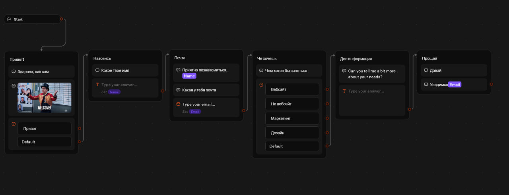
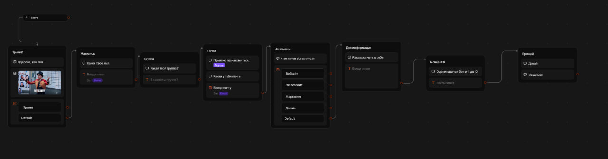
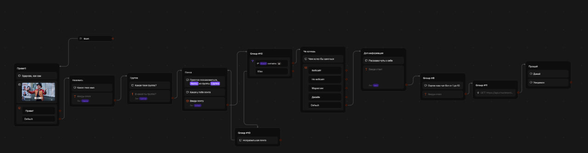
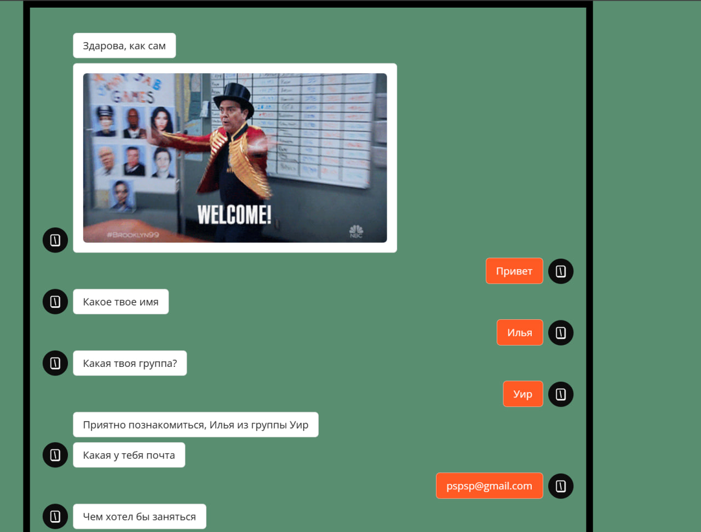

# Отчёт по лабораторной работе №5 (TypeBot)

**Студент:** Помас Илья  
**Группа:** УИР-241

**Трек:** C — TypeBot

---

## Часть 1. Выбор трека и перевод шаблона

Для выполнения лабораторной работы я выбрал трек **C (TypeBot)**, так как это облачная платформа с интуитивно понятным визуальным редактором, которая не требует приглашения других пользователей (в отличие от Botpress) и позволяет быстро экспортировать результат в JSON.

Я создал нового бота на основе готового шаблона (Lead Generation). Первым шагом я полностью русифицировал интерфейс: перевёл приветствие, вопросы, кнопки и плейсхолдеры.

---

## Часть 2. Логика, переменные и интеграции

Согласно заданию, я добавил в шаблон несколько новых элементов и изменил логику работы:

1. **Добавил новые шаги (Input):** 
   * Блок сбора **Группы** (переменная `Group`).
   * Блок оценки качества обслуживания от 1 до 10 (переменная `rating`).
2. **Добавил условие (Condition):** 
   * Настроил проверку введенной почты. Бот проверяет, содержит ли переменная `Email` символ `@`. Если да, то диалог продолжается по ветке успеха, если нет — по ветке ошибки.
3. **Добавил интеграцию (HTTP Request):**
   * Настроил GET-запрос к публичному API `https://api.chucknorris.io/jokes/random`.
   * Ответ сервера сохраняется в переменную `joke` и выводится пользователю в финальном блоке «Прощай».
4. **Изменил тему/брендинг:** 
   * Сменил цветовую схему кнопок и заголовок бота.

**Общий вид флоу в редакторе Typebot:**

---

## Результат работы

**Пример успешного HTTP-запроса (метод GET, ответ 200):**

**Пример диалога с ботом (интерфейс чата):**

**Ссылка на опубликованного бота:** 
https://typebot.co/lead-generation-smrzkj7

---

## Освоенные элементы TypeBot

- **Блоки ввода:** Text, Email, Number.
- **Логика:** Condition (Условие), Set Variable (Сохранение в переменную).
- **Интеграции:** HTTP Request (GET-запросы к внешним API).
- **Оформление:** Theme (смена цветов и брендинга).
- **Публикация:** Publish (Web-ссылка).

---

## Использованные AI-промпты (примеры)

- «Как перевести шаблон TypeBot на русский, не сломав переменные?»
- «Как добавить условие (Condition) для проверки введенного Email в TypeBot?»
- «Как настроить HTTP Request в TypeBot и сохранить ответ в переменную?»
- «Как опубликовать бота в TypeBot и получить ссылку?»

---

## Выводы

В ходе лабораторной работы я освоил TypeBot как low-code платформу для создания чат-ботов. Я научился адаптировать готовый шаблон под свои задачи: перевёл все тексты на русский, добавил новые шаги для сбора данных (группа, оценка), реализовал логическое ветвление с помощью условия (Condition) и настроил интеграцию с внешним API через HTTP Request. 

Главная сложность возникла при настройке HTTP-запроса (нужно было правильно указать метод GET и путь к переменной в JSON), но это помогло лучше понять, как работают API. Ограничения бесплатного тарифа TypeBot (200 чатов в месяц) вполне достаточны для учебных целей.
