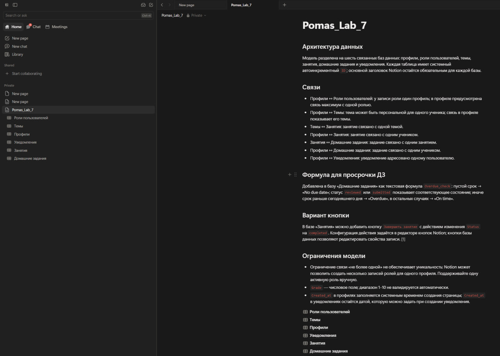
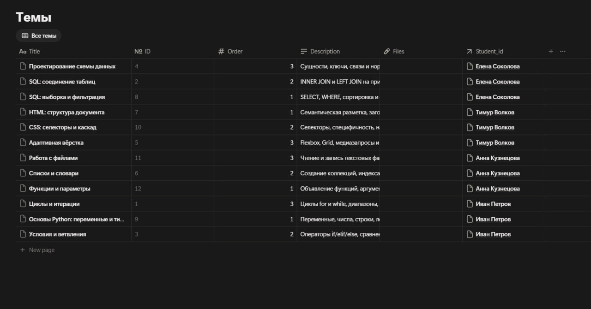
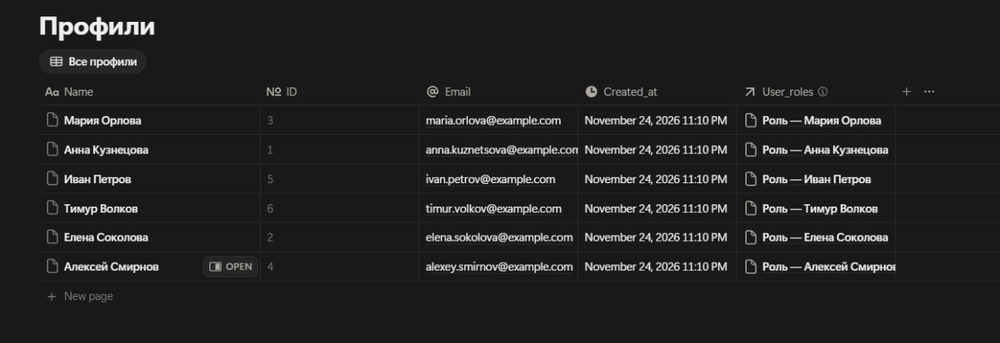
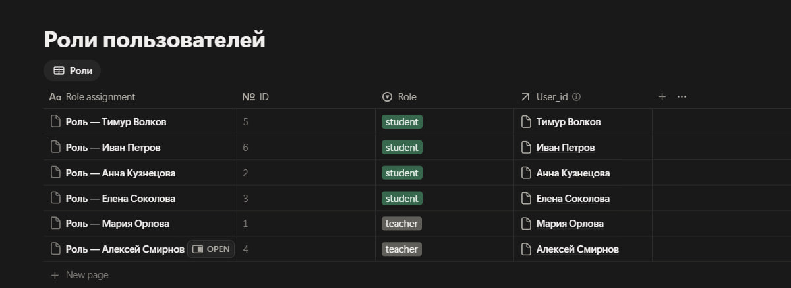
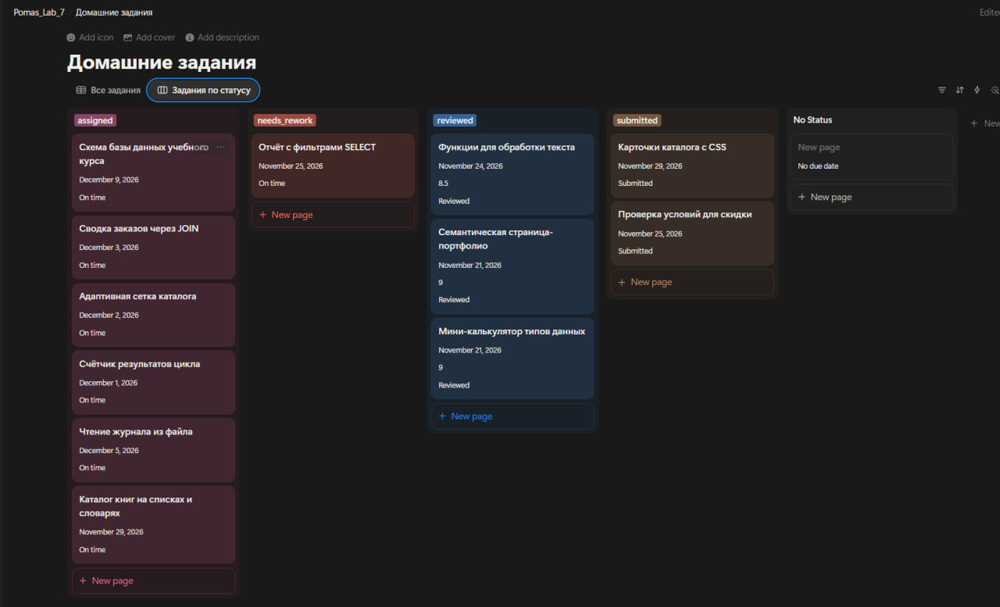
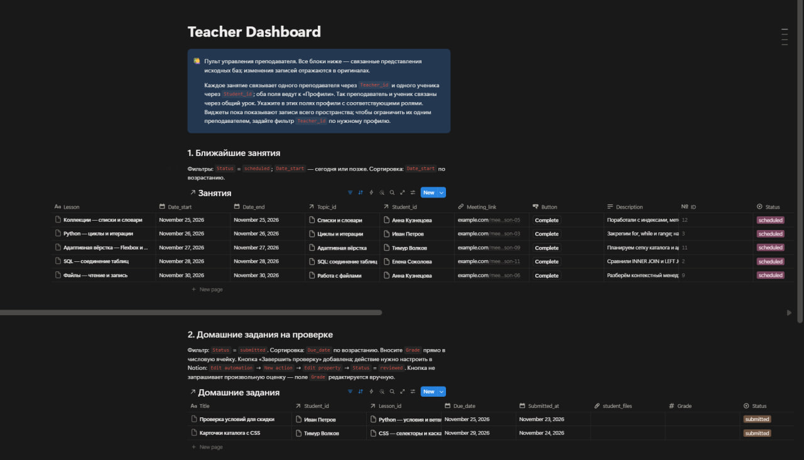
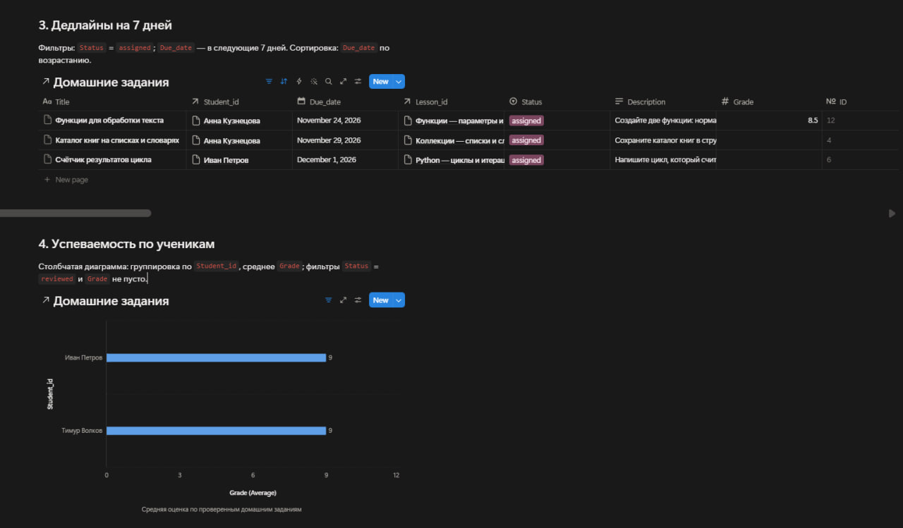
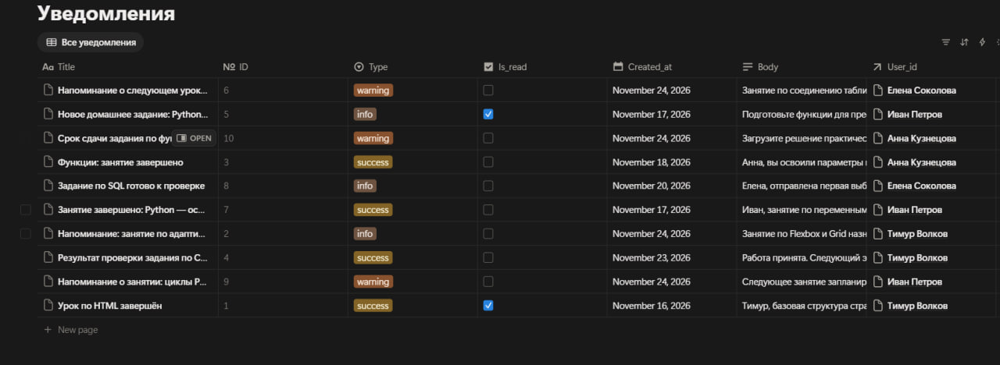
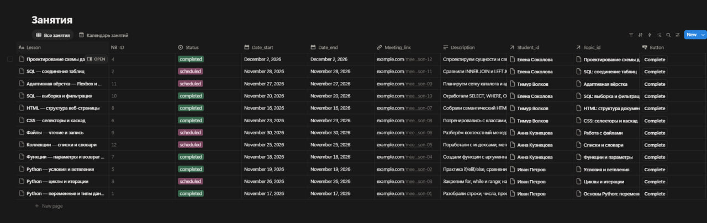

# Отчёт по лабораторной работе №7 (Notion)

**Студент:** Помас Илья  
**Группа:** УИР-241  
**Проект:** lab7-Pomas-notion

## 1. Краткое описание предметной области и модели данных

В качестве предметной области выбрана **образовательная платформа для репетитора по английскому языку **. Модель данных разделена на 6 связанных баз данных, что позволяет вести учёт учеников, составлять расписание и проверять домашние задания.

**Сгенерированная модель данных (6 сущностей):**
1.  **Profiles (Профили)** — основа для всех пользователей (ученики и учителя). Поля: `Name` (Title), `Email` (Email), `Created_at` (Date).
2.  **User Roles (Роли)** — определяет права доступа. Поля: `Role Name` (Title), `Role Type` (Select: teacher, student).
3.  **Topics (Темы)** — учебные материалы. Поля: `Title` (Title), `Description` (Text), `Files` (Files & media), `Order` (Number).
4.  **Lessons (Занятия)** — расписание. Поля: `Title` (Title), `Date_start` (Date), `Date_end` (Date), `Meeting_link` (URL), `Status` (Select: scheduled, completed, cancelled).
5.  **Homework (ДЗ)** — задания. Поля: `Title` (Title), `Description` (Text), `Due_date` (Date), `Status` (Select: assigned, submitted, reviewed, needs_rework), `Grade` (Number), `Teacher_feedback` (Text).
6.  **Notifications (Уведомления)** — оповещения. Поля: `Title` (Title), `Body` (Text), `Type` (Select), `Is_read` (Checkbox).

## 2. Промпты для ИИ, ответы и исправления

### 2.1. Генерация структуры баз данных

**Промпт, который я дал ИИ:**
> «Выступи в роли архитектора баз данных. Спроектируй структуру для образовательной платформы в Notion на основе следующей реляционной модели:
> 1. **Profiles (Профили):** `ID`, `Email` (Email), `Name` (Title), `Created_at` (Date).
> 2. **User Roles (Роли пользователей):** `ID`, `User_id` (Relation к Profiles), `Role` (Select: teacher, student).
> 3. **Topics (Темы):** `ID`, `Title` (Title), `Description` (Text), `Files` (Files & media), `Order` (Number), `Student_id` (Relation к Profiles).
> 4. **Lessons (Занятия):** `ID`, `Topic_id` (Relation к Topics), `Student_id` (Relation к Profiles), `Date_start` (Date), `Date_end` (Date), `Meeting_link` (URL), `Status` (Select: scheduled, completed, cancelled), `Description` (Text).
> 5. **Homework (Домашние задания):** `ID`, `Lesson_id` (Relation к Lessons), `Student_id` (Relation к Profiles), `Title` (Title), `Description` (Text), `Due_date` (Date), `Status` (Select: assigned, submitted, reviewed, needs_rework), `Grade` (Number 1-10), `Teacher_feedback` (Text), `Submitted_at` (Date).
> 6. **Notifications (Уведомления):** `ID`, `User_id` (Relation к Profiles), `Title` (Title), `Body` (Text), `Type` (Select: info, warning, success), `Is_read` (Checkbox), `Created_at` (Date).
> **Требования к связям (Relations):** Свяжи Profiles и User Roles (у пользователя одна роль). Свяжи Lessons с Topics и Profiles. Свяжи Homework с Lessons и Profiles. Свяжи Notifications с Profiles.
> Дополнительно предложи **1 вариант формулы (Formula)** для автоматизации (например, для проверки просрочки ДЗ) и **1 вариант кнопки (Button)** для смены статуса урока или ДЗ».

**Ответ ИИ (кратко):**
ИИ выдал готовую структуру из 6 баз данных, прописал типы полей для каждой и предложил логику связей. Также он написал формулу `if(prop("Due_date") < now(), "Просрочено", "В работе")` и предложил кнопку, меняющую статус с `assigned` на `completed`.

**Что я исправил после проверки:**
В исходном SQL-коде поле `files` было типа `jsonb`. В Notion я заменил его на тип **Files & media**, чтобы файлы можно было загружать прямо в карточку. Также я оставил связи двусторонними (галочка "Show on...") для удобной навигации.

### 2.2. Проектирование Teacher Dashboard (Ачивка 11)

**Промпт, который я дал ИИ:**
> «У меня уже есть 6 баз данных в рабочем пространстве. Все базы связаны между собой через Relation. Задача: Спроектируй для меня Teacher Dashboard (Дашборд преподавателя) — отдельную страницу, которая будет работать как пульт управления.
> 1. Предложи 3–4 виджета (блока), которые должны быть на этом дашборде, чтобы преподавателю было удобно работать.
> 2. Для каждого виджета распиши пошагово, как его реализовать в Notion **без кода и без внешних сервисов** (только стандартные блоки Notion: Linked Views, Callouts, Rollup, Filters).
> 3. Напиши, какие именно фильтры и сортировки нужно применить к каждой базе.
> 4. Предложи, как визуально расположить эти блоки на странице (в колонках, друг под другом и т.д.), чтобы это выглядело эстетично».

**Ответ ИИ (что он предложил):**
ИИ спроектировал структуру дашборда из 4 блоков:
1.  **Callout с инструкцией:** Пояснительный текст для преподавателя.
2.  **Ближайшие занятия:** Linked View базы Lessons с фильтром `Status = scheduled` и сортировкой `Date_start`.
3.  **ДЗ на проверке:** Linked View базы Homework с фильтром `Status = submitted`.
4.  **Успеваемость:** Предложил использовать Chart (диаграмму) с группировкой по ученикам и средним баллом, а также добавить кнопку «Завершить проверку».

**Что я исправил:**
ИИ предложил связать занятия с преподавателем через поле `Teacher_id`. Я уточнил, что в моей модели преподаватель видит все занятия (так как он один), поэтому я не стал добавлять это поле, а сосредоточился на фильтрации по статусам.

## 3. Перечень реализованных ачивок

### 🏆 Ачивка 11: Своя фича (Интерактивный Teacher Dashboard)

Создана отдельная страница-пульт управления. Дашборд агрегирует данные из 4 баз (Profiles, Lessons, Homework, Notifications) и использует продвинутые фильтры, сортировки и представления для визуализации информации.

**Реализованные виджеты на дашборде:**
1.  **KPI-панель (Callout):** Текстовый блок с описанием назначения дашборда и инструкцией по использованию.
2.  **Ближайшие занятия (Linked View):** Фильтр `Status = scheduled`, сортировка `Date_start` по возрастанию.
3.  **ДЗ на проверке (Linked View + Button):** Фильтр `Status = submitted`. Добавлена кнопка «Завершить проверку» (смена статуса на `reviewed`).
4.  **Дедлайны на 7 дней (Linked View):** Фильтр `Status = assigned` и `Due_date` в пределах следующих 7 дней.
5.  **Успеваемость по ученикам (Chart):** Столбчатая диаграмма, группировка по `Student_id`, среднее `Grade`. Фильтр `Status = reviewed`.

**Почему это уникально:** Данный функционал не входит в список стандартных ачивок. Это комплексная композиция из Linked Views, фильтров и встроенной диаграммы, которая превращает Notion в полноценную CRM-систему для управления учебным процессом.

## 4. Ссылка на проект

**Опубликованная страница:** [Вставь сюда ссылку, полученную после Share → Publish]

**Экспортированный файл:** `exports/Export.md`

## 5. Использованные AI-промпты (ключевые примеры)

1.  «Выступи в роли архитектора баз данных. Спроектируй структуру для образовательной платформы в Notion на основе реляционной модели...»
2.  «Спроектируй для меня Teacher Dashboard (Дашборд преподавателя) — отдельную страницу, которая будет работать как пульт управления. Предложи 3–4 виджета...»
3.  «Как в Notion настроить Rollup для подсчета среднего балла по связанной базе?»
4.  «Как в Notion сделать формулу для проверки просрочки дедлайна?»
5.  «Как в Notion настроить кнопку для смены статуса ДЗ с assigned на completed?»

## 6. Освоенные компоненты и настройки Notion

*   **Типы свойств:** Title, Text, Select, Multi-select, Date, Number, Email, URL, Files & media, Checkbox, Relation, Rollup, Formula, Button.
*   **Представления (Views):** Table, Board (Канбан), Chart (для успеваемости).
*   **Фильтры и сортировки:** Фильтрация по статусам (`scheduled`, `submitted`), сортировка по датам.
*   **Связи (Relations):** Двусторонние связи между 6 базами.
*   **Агрегация:** Rollup для подсчета средних значений.
*   **Публикация:** Share → Publish to web.

## 7. Скриншоты

### 7.1. Главная страница (с фамилией)
Видна фамилия **Pomas** на английском языке.

### 7.2. Схема базы данных (Список баз)
На скриншоте видно, что создано 6 связанных баз данных.

### 7.3. Базы данных и связи (Relations)
Показаны настройки связей между таблицами.

### 7.4. Канбан-доска (Представление)
База "Домашние задания" с представлением Board (Канбан), сгруппированная по статусу.

### 7.5. Дашборд преподавателя (Ачивка 11)
Общий вид страницы Teacher Dashboard с виджетами (Ближайшие занятия, ДЗ на проверке, Дедлайны, Успеваемость).

### 7.6. Уведомления
Пример работы связанной базы уведомлений.

### 7.7. Занятия
Таблица с расписанием занятий.

## 8. Ограничения бесплатного тарифа Notion

*   **Лимит блоков:** 1000 блоков на страницу (для дашборда хватило с запасом).
*   **История версий:** Всего 7 дней (для отката изменений достаточно).
*   **Размер файлов:** 5 МБ на файл (для учебных материалов хватает).

## 9. Выводы

В ходе лабораторной работы я освоил Notion как мощную low-code платформу для создания баз данных. Я научился проектировать реляционные модели (сущности и связи), настраивать типы свойств (включая Relation, Rollup и Formula) и создавать интерактивные представления (Канбан, диаграммы). 

Отдельно я реализовал уникальную фичу — **Teacher Dashboard**, который агрегирует данные из разных баз и служит единым пультом управления для преподавателя. Главная сложность была в настройке фильтров для связанных представлений, но после изучения документации всё заработало. Notion показал себя как гибкий инструмент, который может заменить простые CRM-системы.