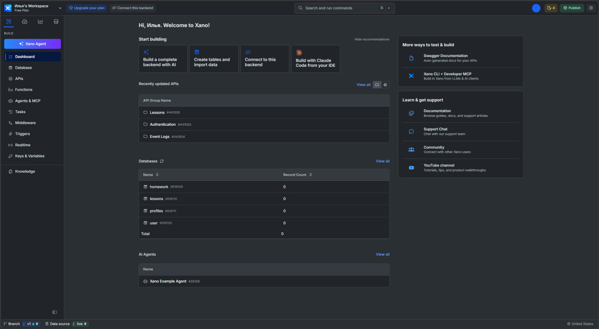
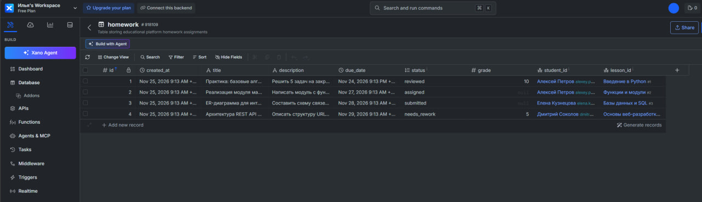
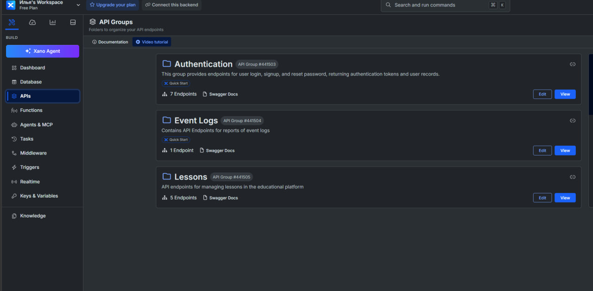
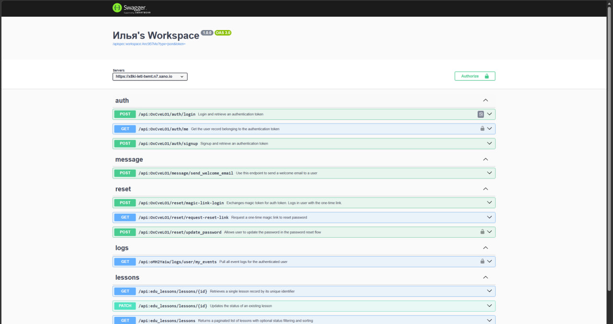

# Отчёт по лабораторной работе №8 (Xano)

**Студент:** Помас Илья  
**Группа:** УИР-241  
**Проект:** lab8-pomas-api

## 1. Краткое описание предметной области и модели данных

В качестве предметной области выбрана **образовательная платформа для репетитора по английскому языку (English Garden Classroom)**. Бэкенд реализован на платформе Xano.

**Сгенерированная модель данных:**
В рамках базового задания созданы следующие таблицы:
1.  **Profiles (Профили):** поля — `Name` (text), `Email` (text), `Role` (enum: teacher, student), `Created_at` (timestamp).
2.  **Lessons (Занятия):** поля — `Title` (text), `Date_start` (timestamp), `Date_end` (timestamp), `Status` (enum: scheduled, completed, cancelled), `Topic` (text), `Student_id` (reference к Profiles).

**Связи (References):**
Настроена связь между таблицами: `Lessons.Student_id` ссылается на `Profiles.id` (Один ученик — много занятий).

## 2. Промпт для ИИ, ответ и исправления

**Промпт, который я дал ИИ:**
> «Выступи в роли архитектора бэкенд-систем. Спроектируй структуру базы данных и API для образовательной платформы на no-code платформе Xano.
> **Модель данных (3–4 таблицы со связями):**
> 1. Profiles (Профили): поля — Name (text), Email (text), Role (enum: teacher, student), Created_at (timestamp).
> 2. Lessons (Занятия): поля — Title (text), Date_start (timestamp), Date_end (timestamp), Status (enum: scheduled, completed, cancelled), Student_id (reference к Profiles), Topic (text).
> 3. Homework (Домашние задания): поля — Title (text), Description (text), Due_date (timestamp), Status (enum: assigned, submitted, reviewed, needs_rework), Grade (integer, 1–10), Student_id (reference к Profiles), Lesson_id (reference к Lessons).
> **Требования к связям (References):** Свяжи Lessons с Profiles. Свяжи Homework с Lessons и Profiles.
> **Требования к типам полей:** Обязательно используй типы text, integer, timestamp, enum, reference.
> **API-эндпоинты (минимум 4 для CRUD):**
> 1. GET /lessons — список всех занятий (с поддержкой query-параметра status для фильтрации).
> 2. GET /lessons/{id} — получение занятия по path-параметру {id}.
> 3. POST /lessons — создание нового занятия (принимает JSON с полями).
> 4. PATCH /lessons/{id} — обновление статуса занятия по {id}.
> Дополнительно предложи, как реализовать пагинацию для GET /lessons (page, per_page, sort)».

**Ответ ИИ (схема):**
ИИ сгенерировал структуру таблиц с правильными типами полей и предложил 4 REST-эндпоинта для работы с занятиями, а также расписал шаги для настройки пагинации.

**Что исправил после проверки:**
Так как в Xano нет строгого типа `enum`, я создал кастомные списки (Custom List) для полей `Role` и `Status`, чтобы ограничить вводимые значения. Связи `reference` были настроены через тип поля `Table Reference` с параметром `Single`.

## 3. Перечень реализованных ачивок

*(Здесь будет список ачивок, которые ты сделаешь. Пока оставь пустым или удали этот раздел, если будешь сдавать только базу)*

## 4. Ссылка на проект

**Ссылка на Swagger (Документация API):**  
`https://x8ki-letl-twmt.n7.xano.io/apispec:workspace:Anc9B7Mu`  
*(Документация открыта для публичного доступа)*

**Экспортированный файл:** `exports/lab8-pomas.zip` *(если сделал экспорт)* или `exports/lab8-swagger.json`.

## 5. Использованные AI-промпты (ключевые примеры)

1.  «Выступи в роли архитектора бэкенд-систем. Спроектируй структуру базы данных и API для образовательной платформы на Xano...»
2.  «Как реализовать пагинацию в Xano для эндпоинта GET?»

## 6. Освоенные компоненты и настройки Xano

*   **База данных:** Создание таблиц, настройка типов полей (Text, Integer, Timestamp, Reference), создание Custom List для эмуляции Enum.
*   **API:** Создание эндпоинтов (GET, POST, PATCH), настройка Path-параметров (`{id}`) и Query-параметров (`status`, `page`, `per_page`).
*   **Function Stack:** Настройка логики запросов (Query All Records, Get Record, Add Record, Edit Record, Filter).
*   **Документация:** Публикация Swagger.

## 7. Скриншоты

### 7.1. Главный экран Xano (Dashboard)
Видно название workspace **Илья's Workspace**.

### 7.2. Схема базы данных (Таблицы)
Скриншот структуры базы данных и полей.

### 7.3. Эндпоинты (API)
Список созданных эндпоинтов.

### 7.4. Swagger (Документация)
Публичная страница Swagger с описанием API. В заголовке видно «Илья's Workspace».

## 8. Ограничения бесплатного тарифа Xano

*   Недоступность Middleware и Triggers.
*   Ограничение на отправку писем (100 писем).
*   Ограничение по размеру workspace (для текущего проекта достаточно).

## 9. Выводы

В ходе лабораторной работы я освоил Xano как платформу для быстрого создания бэкенда (no-code/low-code). Я научился проектировать реляционные базы данных (таблицы и связи), создавать API-эндпоинты для CRUD-операций, настраивать Path и Query параметры. Также я разобрался с автоматической генерацией документации Swagger и смог сделать её публичной.

Главная сложность возникла с пониманием `Function Stack` (логики эндпоинтов), но благодаря встроенным шагам (как `Query All Records`) настройка фильтрации и пагинации стала понятной.